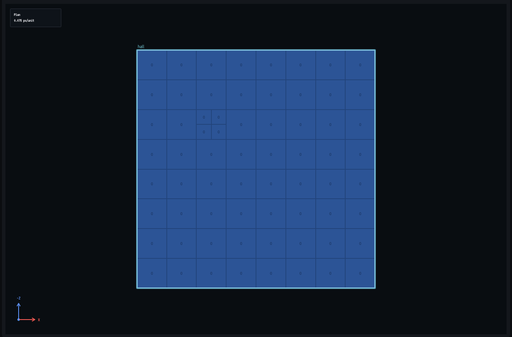
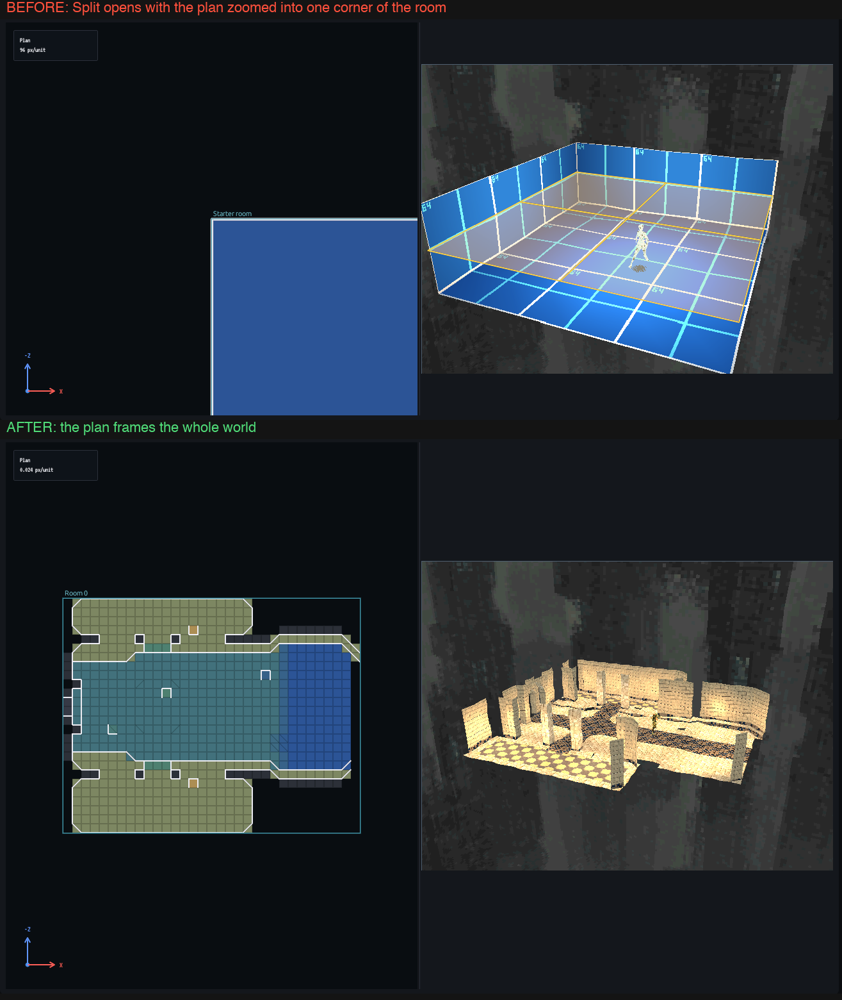
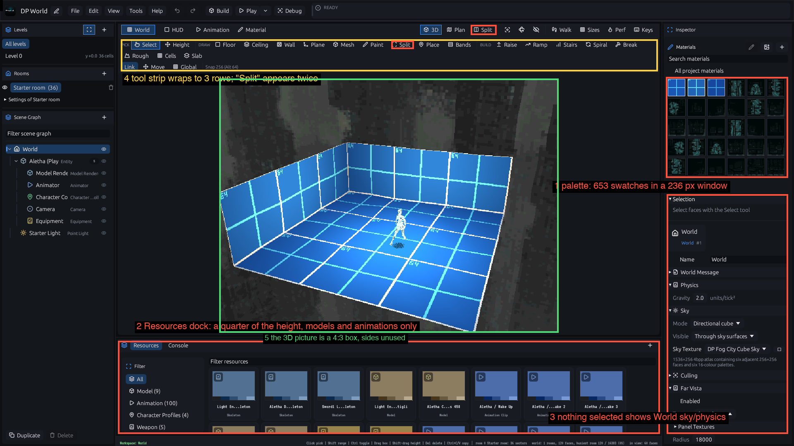
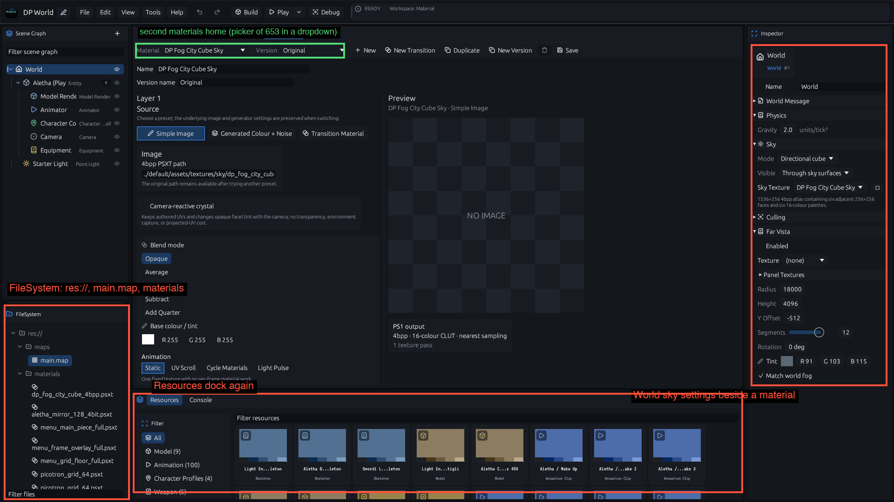
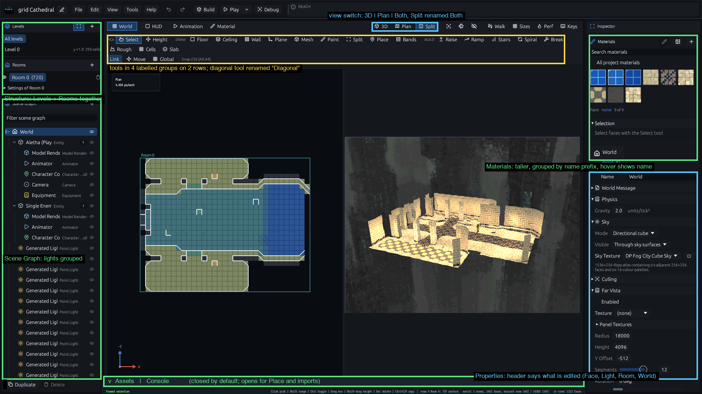

# Grid editor usability audit (2026-10-19)

Trigger (Manny, 10-19): "the editor is SO BROKEN, I tried the split function and you can split but you can't select anything individually, you have 2 materials screen, the one on the right which is nice but it's duplicated with resources at the bottom... we need to do an overall usability assessment and improve the editor BIG TIME".

Method. Every workflow below was driven the way a designer drives it, on the tip of `grid/main` (5b181404, includes the UX pass 32d44206 and the editor perf work), on `editor/projects/grid-starter` and on a copy of Manny's `dp-world` (653 palette materials). Interactions ran through the headless harness (`GridRig`: real egui pointer and key events into the Top, 3D and Split views, `psxed-ui/src/tests/grid_audit.rs`). Pictures are the editor's own headless capture (`frontend dump-editor-ui`, 1920 x 1080, with `--grid-pose`). Nothing launched the GUI. Play (the cook and the guest build) was not exercised here: it needs the bootstrap step and is covered by the MCP playtest tests.

Severity: **P1** broken or blocking, **P2** confusing or duplicated, **P3** polish.

The previous audit (`ux-audit.md`, 10-16) and the UX pass that followed already cleared a lot, so this one only lists what is still true on the tip: the brush leftovers in the menus, the FileSystem panel in the World tab, materials listed in the Resources dock, missing Undo and Redo buttons, the Top view room chips, the "2D" tab name and the Cmd+N brush project are gone.

One fact first. Manny's live checkout (`PSoXide-editor-wt/grid-editor`) is at `d35a24ee`, which is before the UX pass. A binary built there has the materials palette on the right and Materials cards in the bottom Resources dock, exactly the duplicate he describes, and no Levels panel or Split view. The Resources dock no longer lists materials on the tip. If he was running that build, finding 5 below is already fixed on `grid/main`; he needs a rebuild from the tip. This is worth confirming with him.

## The two reported bugs

Both are reproduced with a failing interaction test before any change (see "Evidence" at the end). "Split" is three different things in this editor, and each reading is broken in a different way, so all three were tested.

### 1. P1: the plan cannot pick, paint or lift a piece of a divided sector (Cells tool)



Steps: new or open any grid project, Plan view, Cells tool (Q), click a sector (it becomes four half cells), switch to Select (V) and click one of the four. Nothing is selected, the status bar stays on "Tool: Select". Paint (P) and Height (H) do nothing on those cells either, Shift range and box select skip the sector. The same click in the 3D view works.

Cause: the plan resolves the room under the pointer with `room.sector(x, z)`, which is the level-2 leaf of that sector. A sector the Cells tool divided has no level-2 leaf, so `top_room_at` finds no room and every plan tool gives up before it looks at the leaves. The same applies to a cell of several sectors.

Expected: Blender and TrenchBroom pick the smallest piece under the pointer. bonnie-32 always picked the sector under the pointer. Here the leaf under the pointer, with all its faces.

Tests: `grid_audit::a_divided_sector_is_selectable_one_half_cell_at_a_time_in_the_plan`, `grid_audit::paint_in_the_plan_reaches_one_half_cell`.

### 2. P1: the Split view opens with the plan zoomed into nothing, so "you can't select anything individually"



Steps: open any project, press the **Split** button in the tab row (or Ctrl/Cmd+9). The left half (the plan) shows one blown up cell at 96 pixels per unit; a click picks the whole visible cell, and the 3D half beside it is fine. There is no way to see the world in the plan except pressing `.` twice.

Cause: when the Split view opens the plan asks to be framed once (`fit_pending`), but `frame_viewport` frames the 3D camera whenever the workspace is not in the plan mode, and Split is not. The plan keeps whatever zoom it had (in the headless test it ends up at 787,000 pixels for the room's far corner).

Expected: both halves frame the world (TrenchBroom's 2D and 3D panes each frame their own view).

Test: `grid_audit::the_split_view_frames_the_world_in_the_plan_half`.

### 2b. P2: per-triangle selection does not exist (the Split tool, D)

Steps: Split tool (D), click a floor (its diagonal flips, or with Shift a triangle is voided), Select tool, click each half of the quad in 3D. Both clicks return the same face (one `FaceRef` for either triangle); a voided triangle has no face to click at all. bonnie-32 had a `selected_triangle` (heights and texture per triangle, "tri 1 / tri 2" in the face panel). Paint and the Height tool's Alt-drag already address a single triangle; Select and the Inspector do not. Proposal: a face pick on a split-level quad also records the triangle, the Inspector shows "Triangle A / B" with its own material and heights.

### 2c. P2: two buttons called Split

The tab row has a view switch (3D, Plan, **Split**) and the tool strip has a **Split** tool (flip a diagonal, key D). Both read "Split" side by side (`ann-1`). The tool is now **Diagonal** (done, key D unchanged); the view stays Split.

## Concept homes (one home per concept)

| Concept | Homes today | Verdict |
|---|---|---|
| Browse materials | right palette (World tab); Material tab picker (a dropdown of 653); FileSystem `materials/` folder in the HUD, Animation and Material tabs | 3 homes. Keep the palette. The Material tab is the editor of the palette's material, not a second browser; FileSystem goes. |
| Resources (models, animations, characters, weapons) | bottom Resources dock (every tab); FileSystem tree (HUD, Animation, Material tabs) | 2 homes. Keep the dock, make it a closed drawer. FileSystem goes. |
| Edit a material | Material tab; the pencil in the palette (opens it); Inspector when a material resource is selected | fine once the tab opens on the palette's material |
| World settings (sky, physics, far vista) | Inspector as the "nothing selected" fallback; Scene Graph root row; World Message | 2 homes. Keep the Scene Graph root; the fallback should be a hint. |
| Room settings | Rooms panel "Settings of ..." (collapsed) | 1 home, good |
| Storeys | Levels panel; Level chip in the viewport; Alt+Up/Down | 1 panel, fine |
| What is hidden | eye in Rooms; eye on every Scene Graph row; Visibility icon in the tab row | 3 homes, three meanings (room, node, overlays). Label the icon. |
| Messages | top READY badge; bottom bar message; "Editor ready" text in non-World tabs | badge = state, bar = message; the second text in non-World tabs goes |
| Split | view switch; Split tool | see 2c |
| Undo, Redo | top buttons; Edit menu; keys | normal, keep |
| Snap | option row label; key hints; Plan info box | 1 label is enough |





## Ranked findings

| # | Sev | Finding | Reproduce | Expected | Evidence |
|---|---|---|---|---|---|
| 1 | P1 | Divided sector cannot be picked, painted or lifted in the plan | Cells tool click, Select/Paint/Height on a half cell in Plan | smallest piece under the pointer | test, `ann-5` |
| 2 | P1 | Split view opens with the plan unframed | Split button | each pane frames the world | test, `ann-3` |
| 3 | P2 | FileSystem panel (res://, fake `main.map`, `materials/` folder) in HUD, Animation, Material tabs duplicates the Resources dock | Material tab, left dock | one home per concept | test, `ann-2` |
| 4 | P2 | The Material tab is a second materials browser (dropdown of 653), and shows the World sky settings in the Inspector while editing a material | Material tab | Inspector shows the material's own context | `ann-2` |
| 5 | P2 | Resources dock lists materials (old build d35a24ee only) | open the Resources dock with Materials filter | one palette | fixed on tip |
| 6 | P2 | No per-triangle selection; a voided triangle cannot be picked in 3D | Split tool, then Select both halves | bonnie-32 `selected_triangle` | probe |
| 7 | P2 | Two buttons named Split | tab row and tool strip | distinct names | `ann-1` |
| 8 | P2 | Palette at 650 scale: 653 flat swatches in a 236 px window (about 5 rows visible), no grouping, no recents, names only on hover; dp-world names are `DP 0.0` to `DP 102.n` | dp-world, World tab | grouped by prefix, taller, recents, name under the cursor | `ann-1` |
| 9 | P2 | Nothing selected shows the full World sky and physics form (about 600 px), with a Materials palette above it even when a light or spawn is selected | click empty space; Place a light | a hint line; context header | `ann-1` |
| 10 | P2 | Resources dock takes a quarter of the height all the time (models and animations only), while the 3D picture is a 4:3 box with unused sides | any grid project | closed drawer | `ann-1` |
| 11 | P2 | Place returns to Select after one click and the status "Placed Light at..." is overwritten by "Tool: Select (V)"; a row of lights is one click per tool switch | Place, click twice | stay in Place (Shift to repeat, as with Paste) and keep the message | probe |
| 12 | P2 | Scene Graph is flat: the Cathedral lists 14+ "Generated Light" rows between the actors | open grid-cathedral | grouped lights, filter by type | `ann-4` |
| 13 | P3 | Paint material is "none" at open, so the first Paint click says "Pick a material in the palette first" | open a project, P, click | the first world material is current | probe |
| 14 | P3 | Tool strip wraps to three rows at 1920 px; the PICK, DRAW, BUILD groups put Paint, Split, Place and Bands under DRAW and leave Rough, Cells, Slab on a wrapped row | any project | grouped, two rows | `ann-1` |
| 15 | P3 | "Link, Move, Global" sit on the third strip row with Select even when no node is selected | Select tool | only with a node selected | `ann-1` |
| 16 | P3 | Frame, Camera and Visibility are unlabelled icons in the tab row | tab row | labels or tooltips shown | `ann-1` |
| 17 | P3 | Status bar is 9 px monospace: message, key hints and the face budget in one line | bottom of the window | larger, budget its own chip | `ann-1` |
| 18 | P3 | Debug button in the main bar (writes `logs/editor_debug.log`) | top bar | move into Tools | `ann-1` |
| 19 | P3 | The Keys page is a three column wall of text with no search | Keys | searchable, per tool | screenshot c04 |

Items 1 and 2 are fixed on this branch with their tests. Items 3 and 11 to 13 are fixes that do not depend on the layout and follow.

## Proposed panel layout



This is the real editor with its Resources dock closed and the Split view framing fixed, annotated with the changes; the unannotated parts are what ships today.

```
+---------------------------------------------------------------------------------------+
| logo Name*  File Edit View Tools Help | Undo Redo | Build  Play v  Stop | READY        |
+---------------------------------------------------------------------------------------+
| [World] [HUD] [Animation] [Material]            View [3D | Plan | Split]  Walk Sizes Perf Keys |
| PICK Select Height | DRAW Floor Ceiling Wall Plane Mesh Paint Diagonal | PLACE Place ... |
| BUILD Raise Ramp Stairs Spiral Break Rough Cells Slab  | tool options | Snap             |
+-----------------+--------------------------------------------+------------------------+
| Structure       |                                            | Materials              |
|  Levels         |   Plan (left)  |  3D (right)               |  search  groups  + img |
|  Rooms          |   both frame the world                     |  grouped swatches      |
|-----------------|                                            |  (fills the dock)      |
| Scene Graph     |                                            |------------------------|
|  Lights (14)    |                                            | Properties             |
|  Actors         |                                            |  header: Face | Light  |
|  Search         |                                            |  | Room | World       |
+-----------------+--------------------------------------------+------------------------+
| v Assets | Console   (closed; opens for Place and imports)                              |
| status message | key hints                          faces 120 / 16383 | room 36 sectors |
+---------------------------------------------------------------------------------------+
```

Rules:

1. Materials: one palette, right dock, taller, grouped by name prefix (`DP 12.*`, `Graybox /`), search, recents, `+` and import. The Material tab edits the palette's current material and its left dock shows the same palette. FileSystem is not drawn for a grid project in any tab.
2. Assets (models, animations, characters, weapons, audio): a bottom drawer, closed by default, opened by Place when a model is needed.
3. Properties has a header that names what is edited (Face n, Triangle, Light, Room, World). Nothing selected shows a hint and a World button, not the sky form.
4. Structure: Levels and Rooms in one panel; Scene Graph groups lights and actors.
5. The view switch stays `3D | Plan | Split`; the diagonal tool is `Diagonal` (done).
6. The strip groups: Pick, Draw, Place, Build, on two rows.

Nothing of this layout is built yet. It waits for Manny's decision.

## Evidence

Failing before, passing after (host tests, `psxed-ui --lib`):

* `grid_audit::a_divided_sector_is_selectable_one_half_cell_at_a_time_in_the_plan`: failed with `clicking the north-east half cell selected nothing of it: 0 items, 0 faces`.
* `grid_audit::paint_in_the_plan_reaches_one_half_cell`: failed with `nothing was painted`.
* `grid_audit::the_split_view_frames_the_world_in_the_plan_half`: failed with `the room spans [615.5 497.0] to [787047.5 786929.0] but the plan half is [[294.0 191.0] - [937.0 803.0]]`.

The exploratory probes that printed what a designer would see (paint with no material, Place twice, delete and undo, 653-material frame cost: 1.2 ms a frame in a debug build, so not a perf problem) were run once and are not kept.

## Status after the layout rework (2026-10-19)

Landed on `grid/main`, each with host interaction tests (`psxed-ui/src/tests/grid_audit.rs`, `grid_triangles.rs`, `grid_material_tab.rs`, `grid_layout.rs`):

| # | Finding | State |
|---|---|---|
| 1 | Divided sector cannot be picked in the plan | fixed |
| 2 | Split view unframed | fixed |
| 3 | FileSystem panel in the other tabs | removed for grid projects |
| 4 | Material tab: second browser, World form in the Inspector | opens on the paint material, picking there is the paint material, the Inspector is about the material |
| 5 | Resources dock listing materials | fixed on the tip (UX pass) |
| 6 | No per-triangle selection | `GridElement::Triangle`: pick in plan and 3D, void triangles pickable, material, Delete (void), Shift-drag |
| 7 | Two buttons named Split | the tool is Diagonal, the view switch reads 3D, Plan, Both |
| 8 | Palette at 650 scale | grouped by name prefix, closed groups on a big world, Recent row, taller window |
| 9 | Nothing selected shows the World form | Properties header and a hint; World settings button or the World row |
| 10 | Resources dock takes a quarter of the height | Assets drawer, closed bar by default, Place (model, character) and model import open it |
| 11 | Place returns to Select and loses its message | message kept, Shift+click keeps the tool |
| 12 | Flat Scene Graph of lights | three or more sibling lights are one `Lights (n)` row |
| 13 | Paint material none at open | the first palette material |
| 14 | Tool strip wraps to three rows | PICK, DRAW, FINISH, BUILD on two rows |
| 15 | Link, Move, Global with nothing to act on | Link with Height or a pick, Move and Global with a selected node |
| 16 | Unlabelled icons | Frame, Camera, Show |
| 17 | 9 px status bar | message, hints and budget chips at 12 to 13 px |
| 18 | Debug in the main bar | Tools menu |
| 19 | Keys page | search box |

The Structure panel (Levels and Rooms under one header) and the Properties header are the layout proposal's left and right docks. Open: the Material tab's left dock still shows the Scene Graph (the palette is not repeated there), the Plan's stairs ghost label clips at the pane edge, and the Properties header does not yet name a selected light by kind.
